
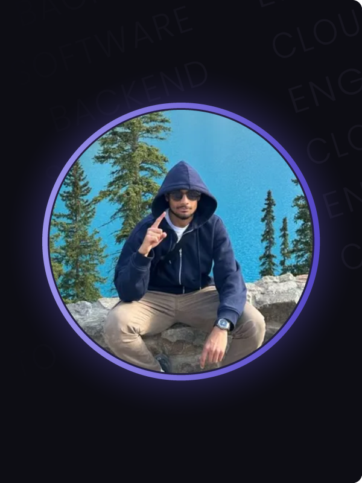

 
<a href="https://www.gauravdivecha.com/projects">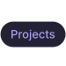</a> 
 
 
 
 
<a href="https://www.gauravdivecha.com/certifications">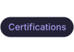</a> 
 

Hey, I'm Gaurav 👋 New grad software engineer from TMU with two Amazon and three Dayforce internships behind me. I build systems that stay up and interfaces that feel right, and I'm getting deep into AI/ML. Quick tour below, the full story's on my site.

 

---

 

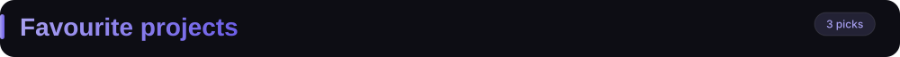

 


**ReliaNet** · a 5-node fault-tolerant key-value store for disaster response that stayed up through **40% node loss**. *Python, FastAPI, gRPC, RabbitMQ, Docker.* [Case study →](https://www.gauravdivecha.com/projects/relianet)

 


**LukAlive** · a four-service attendance platform that reads faces from a live webcam. I led development and architected the stack. *React, TypeScript, Node.js, MongoDB, Flask, TensorFlow, Docker, Firebase.* [Case study →](https://www.gauravdivecha.com/projects/facial-recognition-attendance-system)

 


**App.ly** · a Discord bot I built solo and still use weekly to track job and internship postings. It keeps no database; the channel's messages are the data. [Case study →](https://www.gauravdivecha.com/projects/apply-bot)

 

---

 

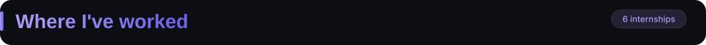

 

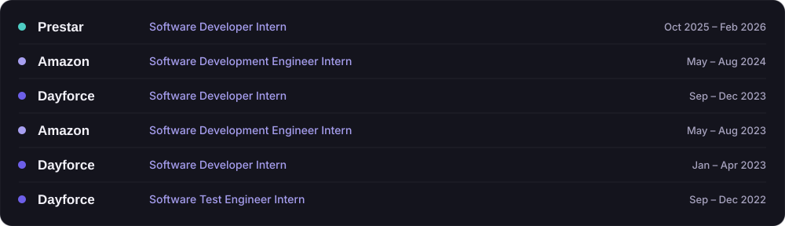

 

---

 

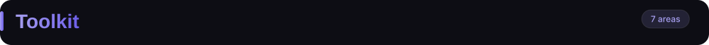

 


Right now I'm working toward the **AWS Certified Solutions Architect – Associate** and Ed Donner's **AI Engineering** path.

 

---

 

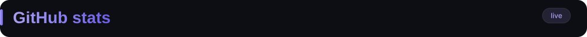

 

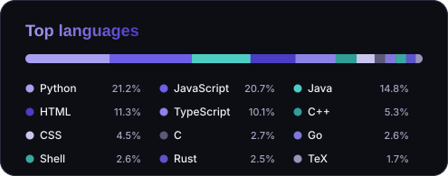

 

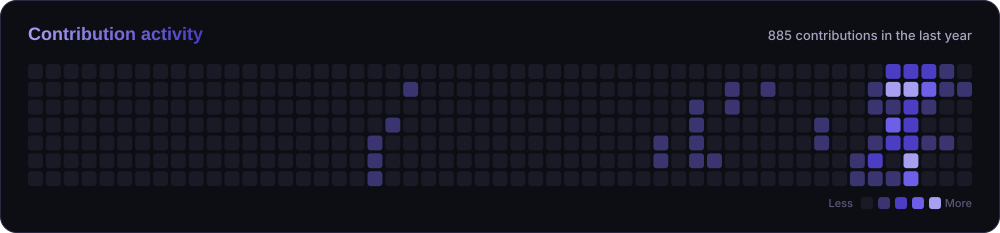

 

---

 

 

 
 

